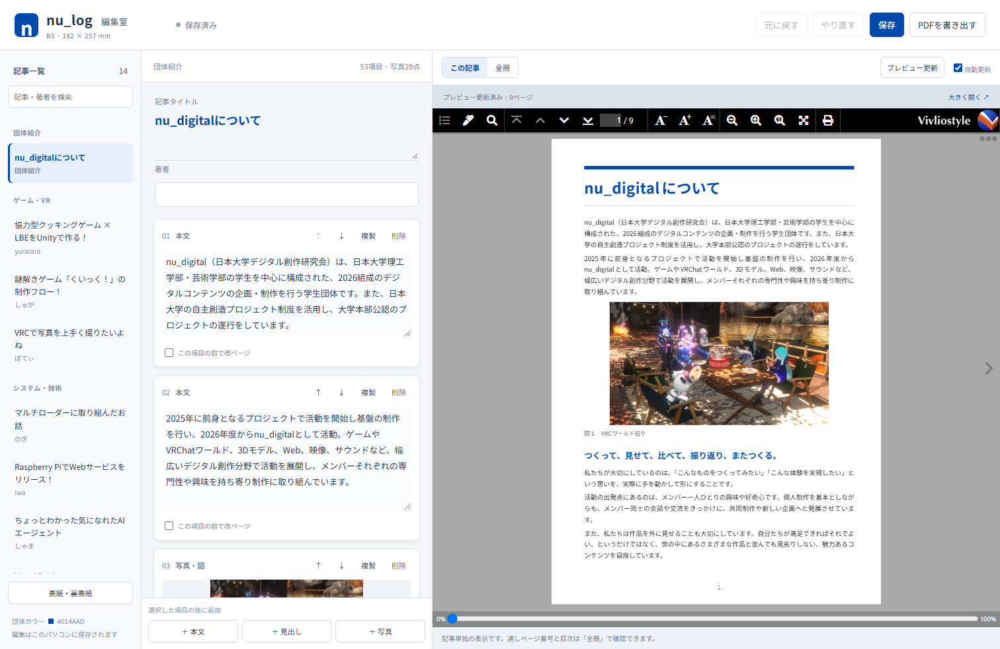

# nu_log Vol.01

nu_digitalの団体誌を、**Vivliostyle・B5（182 × 257mm）**で組版するプロジェクトです。
本文・写真を編集できるローカルエディター「nu_log 編集室」を同梱しています。



## はじめる

### 必要なもの

- Node.js **22.12以上**（npmを含む）
- Windows 10 / 11：同梱の起動ファイルとPDF出力はMicrosoft Edgeを使用します。
- 推奨フォント：**Noto Sans JP**。未インストール時は游ゴシックなどにフォールバックするため、改行・ページ数が変わる場合があります。

```powershell
git clone https://github.com/nu-digital/nu_log-vol.1.git
cd nu_log-vol.1
npm ci
npm run editor
```

ブラウザーで **http://127.0.0.1:4177** を開きます。
依存パッケージのインストール後は、**「エディターを開く.cmd」をダブルクリック**して起動することもできます。

## 編集する

1. 左の記事一覧から記事を選択します。
2. 中央でタイトル・著者・本文・写真・キャプションを修正します。
3. 右のVivliostyleプレビューで仕上がりを確認します。
4. **保存**（Ctrl+S）で保存し、**PDFを書き出す**で全冊を出力します。

写真の差し替え、幅・高さの上限、1列／2列、順序変更、項目の前での改ページに対応しています。
元に戻す（Ctrl+Z）、やり直す（Ctrl+Shift+Z）、未保存の下書き復元も利用できます。

「この記事」は記事単独のプレビューです。実際の通しページ番号、目次、見開きの左右は**「全冊」**で確認してください。
取得済み95点から写真を選べます。新規画像のアップロードや自由座標へのドラッグ配置は未対応です。

詳しい操作は [エディターの使い方](editor/使い方.md) を参照してください。

## 原稿と保存

| パス | 用途 |
| --- | --- |
| `editor/data/book.json` | **編集の正本**。文章・写真配置・設定を保存 |
| `manuscripts/book.html` | 正本から生成する組版用HTML |
| `assets/images/` | 本文・表紙・裏表紙に使用するWebP画像 |
| `styles/book.css` | 判型・余白・書体・団体カラーの設定 |
| `vivliostyle.config.js` | Vivliostyleの入力・出力設定 |
| `reports/images.json` | 画像の対応、サイズ、SHA-256 |
| `reports/image-dimensions.json` | 画像のピクセル寸法 |
| `editor/` | 編集画面・ローカルサーバー・データ変換 |
| `scripts/` | 組版・起動・画像変換・検証用スクリプト |

保存前のデータは `editor/data/history/` にローカル保存されます。履歴・ログ・ブラウザーの下書きはGitでは共有しません。
**HTMLを直接編集すると再生成で上書きされるため、通常はエディターから編集してください。**

```powershell
# 保存済みの編集内容からHTMLを再生成
npm run typeset

# Vivliostyleのプレビュー
npm run preview

# PDFを生成（Windows / Edge）
npm run build -- --executable-browser "C:/Program Files (x86)/Microsoft/Edge/Application/msedge.exe"
```

- コマンドからのPDF：`output/pdf/nu_log.pdf`
- エディターからのPDF：`output/editor/nu_log.pdf`
- 他の環境でエディターからPDFを出力する場合は、起動前に `NU_LOG_BROWSER` へ対応するChromium系ブラウザーの実行ファイルを指定してください。

## デザインと画像

- 判型：国内B5、182 × 257mm
- 団体カラー：**#014AAD**
- 本文：Noto Sans JP、10ptを基本とする日本語横組み
- 表紙・目次・14記事・裏表紙の構成
- モダンでシンプルに、写真と説明の関係・読みやすさを優先

画像95点は**ロスレスWebP**です。元画像と変換後のデコード済みRGBA画素を比較し、一致を確認しています。寸法を維持し、QRコードや操作画面も再圧縮による劣化を避けています。
容量の集計は [画像最適化レポート](reports/image-optimization.json) に記録しています。

元画像はGoogle Docsから取得した素材であり、撮影・制作時の原寸ファイルとは限りません。
原本PNG/JPEG、Google Docsの取得データ、一時アクセスURL、編集コメント、生成PDF、作業ファイルはリポジトリに含めません。
元データを再取得するスクリプトは初期取り込み用です。編集開始後は素材の上書きを防ぐため停止する仕様です。

## 検証

```powershell
npm run test:editor
node scripts/editor-integration.mjs
node scripts/editor-smoke.mjs
```

- モデルテスト：原稿・画像・リンクの保持、画像設定と改ページ、入力検証
- 統合テスト：一時コピーで保存、再起動、競合検知、履歴、再生成を確認
- ブラウザーテスト：Windows / Edgeで記事・全冊プレビュー、編集・取り消し、画像選択を確認

ブラウザーテストは `npm run editor` を起動した状態で実行します。初稿の68ページを基準にするため、編集でページ数が変わった場合は期待値も調整してください。
画像変換を再実行する場合のみ、PythonとPillowが必要です。通常の編集・PDF出力には不要です。

## 制作状況

初稿はカラーの確認用です。本文の著者校正、表記統一、印刷所の塗り足し・色・入稿条件への調整は別工程です。
依存パッケージのバージョンは `package-lock.json` で固定しています。エディターは127.0.0.1のみで待ち受けるローカル用途を想定しています。
