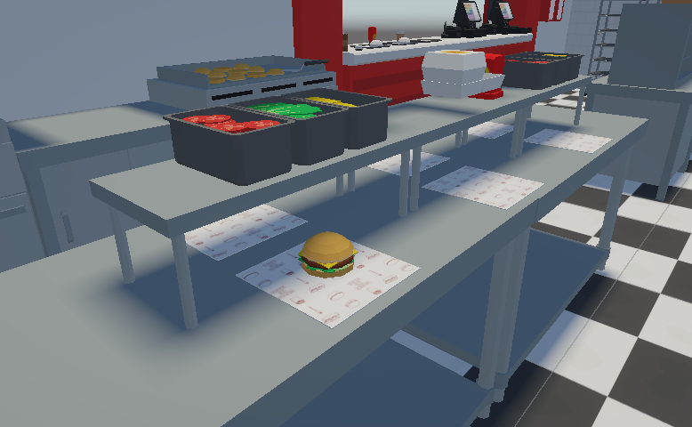
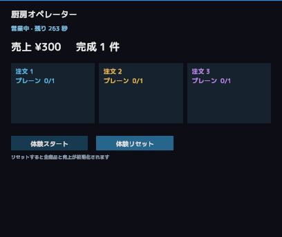
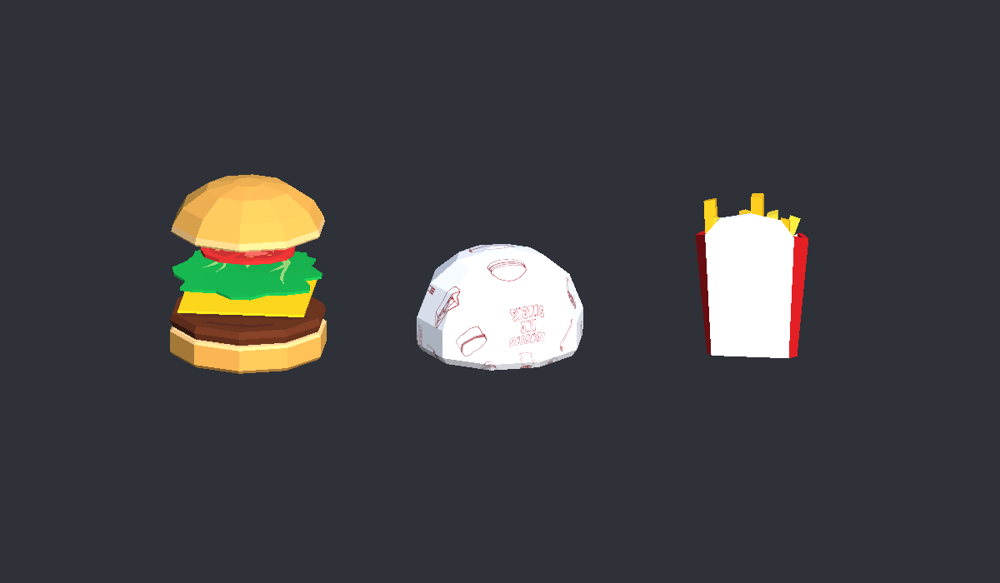
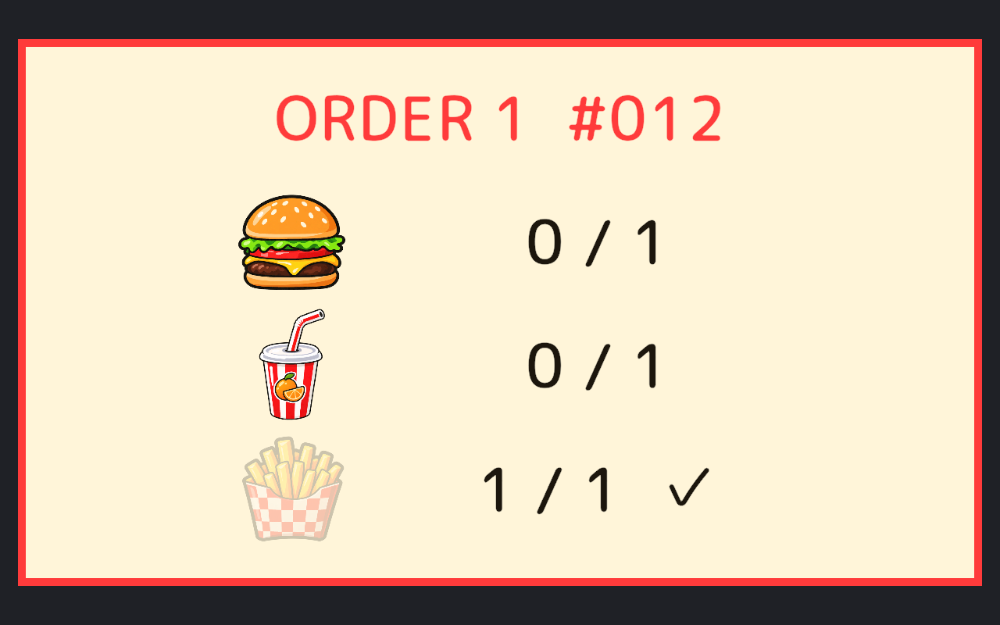
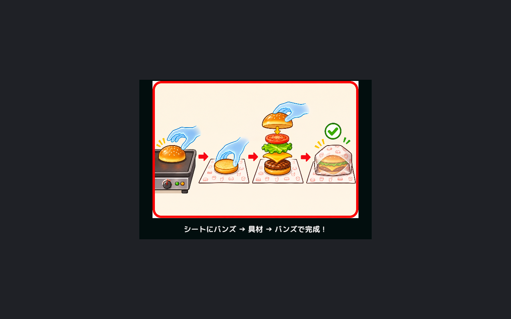

# 協力型クッキングゲーム × LBEをUnityで作る！ 2

Inter BEE展示に向けたブラッシュアップとAIエージェントとの開発

著者：yurarara

前回、STYLY NetSyncを使って、同じ場所にいる人たちが仮想の厨房で料理を作るLBEコンテンツを試作しました。その後、Inter BEE IGNITION × DCEXPO ANNEXで展示し、来場者に遊んでもらえる機会をいただきました。

せっかく人に触ってもらえるなら、以前の反省を踏まえて、見た目も動作も整えて持っていきたい。今回はファストフード店でハンバーガーやドリンクを作る「FastFood!!」として、アセットを使った見た目の改善と、ゲームシステムの構成の見直しを進めました。

開発ではCodexを使い、Astraと仕様を相談しながら実装を進めました。自分が配置や遊び方を考え、エージェントがコードを書き、テストやビルドまで進める。その往復で何が楽になり、どこに課題が残ったのかを振り返ります。

## 四角い試作から厨房らしい見た目へ

以前の試作では、仮の四角いモデルを使っている部分があり、同期したオブジェクトがずれたり、掴んだ食材が少し遅れてついてきたりすることもありました。料理を繰り返し扱うゲームなので、小さな違和感でも積み重なると気になります。

今回は厨房や食材のアセットを使い、調理台、食材、ドリンクマシン、提供カウンターを配置しました。見た目が料理らしくなると、「あれを取って、ここで作る」という行動もイメージしやすくなります。

*厨房と作業シートの参考スクリーンショット。ブラッシュアップ途中の配置で、展示当日のHMD映像ではありません。*

配置は自分でもUnity上で調整しました。机を広げる、食材を増やす、物の位置を変える。その後でエージェントに「移動後の配置に反応範囲を合わせてほしい」と依頼する進め方です。最終的には、判定を対象物の移動に追従させる仕組みも入り、配置を試す作業がしやすくなりました。

## まず調査してから仕様を決める

最初からゲームを丸ごと作り直してもらったわけではありません。まず既存プロジェクトのUnityやSDKのバージョン、シーン、同期の仕組み、ビルド設定を調べてもらいました。

そこで見つかったのが、AndroidのBuild Profileに存在しないシーンが登録されていることや、運営側のアバター参照が切れていることでした。こうした土台の問題を修正し、PICO用APKとWindows運営版をビルドできるようにしてから、ゲームの中身へ進みました。

仕様相談では、5〜6人程度で協力する想定、途中まで作ったバーガーに別の人が具材を足せること、トレー1枚に注文1件を対応させることなどを整理しました。バーガーは具材の順番を自由にしつつ、注文としての正解は種類と個数で判定する方針です。

自分が遊びの方向を伝え、エージェントが曖昧なところを質問し、決まった内容を引き継ぎ文書に残す。相談ではAstraの高い推論設定を使い、実装は軽めの設定へ渡す進め方も試しました。後半には別モデルへの切り替えも試しており、全工程を一つのモデルだけで完結させたわけではありません。

実装の最初の目標は、バーガー1個の「取得→調理→包装→提供→売上加算」を通すことでした。この小さな一周を確認してから、ドリンクやポテト、注文、体験の開始・終了へ広げていきました。

## 物の動きと料理の状態を分けて考える

前回も、運営側で結果を確定する考え方や、固定IDを付けたオブジェクトのプールを使っていました。今回はそれを踏まえて、厨房で必要な情報を整理し直しました。

例えば、共有したいのは「このシートには何の具材が積まれているか」「誰の右手に何があるか」「注文は何品そろったか」といった状態です。利用者側が操作を要求し、運営側のUnityクライアントが受け付けた結果を確定します。Python製のNetSyncサーバーは、その通信をつなぐ役割です。

確定した状態を各端末が受け取り、手元やシート、トレーに対応する見た目を表示します。厨房の食品表示には独自のTransform通信を追加せず、頭や手の姿勢には標準のアバター同期を使う構成になりました。

同じ物を二人が同時に取ろうとしたとき、同じ提供要求が再送されたときも、二重取得や売上の二重加算を防ぐ必要があります。操作IDや状態の更新番号を使い、そのような条件をテストできるようにしました。レシピや売上のロジックも通常のC#クラスに分けています。

ただし、これで物理空間の原点合わせや通信遅延まで解決したという話ではありません。共有するゲーム状態を整理することと、実際のHMDで位置や操作感を確認することは、それぞれ必要でした。

## uLoopで実装と確認を往復する

今回助かったのは、コードの変更に続けて、エージェントがテストや表示の確認まで進めてくれたことです。Unity CLI Loop（uLoop）を使ってEditorの状態やConsoleを調べ、コンパイル、EditMode・PlayModeテストを実行しました。

もちろん、ツールが毎回そのまま動いたわけではありません。動的C#実行がテンプレート欠落で失敗した場面では、プロジェクト内のEditor補助スクリプトを使って作業を続けました。実際の表示コードからプレビュー画像を出し、文字のはみ出しや食材の見え方も確認しています。

*11月14日の運営画面。売上300円・完成1件の表示と、開始・リセットの操作を確認した開発中の画面です。*

PC上では、Windows運営版からサーバーを経由してUnity Editorの利用者側へ操作を通し、提供と売上加算を確認しました。別の通信テストでは、Pythonのテストクライアントを使い、同時取得、同じ要求の再送、途中参加時の状態取得も確認しています。

最後の追加ブラッシュアップでは、EditMode 32件、PlayMode 4件が成功し、PICO用とWindows運営用の両ビルドも成功しました。この数字はPC上の自動検証とビルドの結果です。HMDの装着感や来場者への伝わり方は、実際に体験してもらって確かめる必要があります。

自分で一つずつ調べて修正し、テストし、ビルドし直すところまで考えると、この往復を任せられるのはかなり効率的でした。簡単なモックを作って試す用途にも向いていそうだと感じます。

## 遊んだ感想を具体的な変更にする

土台が動いてからは、「近くに持っていったのに注がれない」「完成したバーガーを少し見ていたい」といった感想を、そのまま改善の相談として伝えました。

ドリンクは注ぎ口の反応範囲を広げ、バーガーは完成時に歓声を鳴らして、約2秒完成形を見せてから包装するようにしました。完成した注文も約2.5秒残してから回収します。すぐに結果だけが処理されるより、自分たちで作ったものを見る時間がある方がうれしい、という調整です。

*実際の食品アセットと表示処理を使った検証用プレビュー。完成形、包装、手に持つ食品の見た目を確認しました。*

上の4台のモニターには、売上・残り時間と、トレーごとの注文を表示しました。文字だけだった案内に商品アイコンと個数を加え、後から提供トレーの近くにも小さな注文表示を追加しています。

*注文モニターの検証用プレビュー。必要数と提供済みの数、完了チェックを表示しています。*

自分が用意したスクリーンショットや商品アイコンを参考に、バーガー、ポテトとドリンク、提供方法の3枚の説明画像も生成しました。短い説明の後は、実際の操作に応じて矢印の案内先が切り替わります。展示では約7分で入れ替える想定があったため、長い練習時間を取るかどうかも相談して決めた部分です。

*生成した説明イラストに短い文字説明を添えたUIプレビュー。イラストの手は操作の概念図です。*

さらに、失敗が続くと遊びにくいという感触から、提供ルールも変更しました。正しいセットなら売上を加算し、違う内容でもトレーに3品そろえば減点せず回収して、次の注文へ進みます。バーガーやポテトを誰でも取り出せる共有保管場所も作りました。

こうした判断は、エージェントが自動テストだけで決められるものではありません。「現実寄りのシミュレーションにしたいけれど、成功体験も持たせたい」という自分の方向性を伝え、提供ルール、判定、音、UIへ落とし込んでもらいました。

## ビルドが楽になった分だけ手順も手元に置く

PICO用APKとWindows運営版の両方を、一度の依頼でまとめて用意してもらえるのは助かりました。実際の処理はそれぞれのビルドを順に実行する形ですが、出力先やログ、ビルドを識別するIDまでそろえてくれます。

途中ではAndroidのGradle処理がローカル接続のエラーで止まりました。ログを調べ、ビルド子プロセスのJava用一時保存先を指定することで、APKの生成まで進めています。また、Windows側でUnityや運営版がクラッシュしたときは、ログからDirect3D 12の描画経路を調べ、相談のうえDirect3D 11へ切り替えて起動を確認しました。

こういうところは、人力で原因を調べて試行錯誤すると時間がかかります。エラーを見て対処し、もう一度ビルドするところまで進めてもらえるのは、今回かなりありがたかった部分です。

一方で、自分がいつものGUI操作でビルドしようとすると、エージェントに任せたときと同じ手順にならず、結局また頼る感覚もありました。実際には手動実行できるPowerShellスクリプトとUnityメニューがありましたが、Javaの一時フォルダ対策はスクリプト側だけに入っていました。

「エージェントがビルドできる」ところまで整ったら、自分でもすぐに使える入口と手順を用意しておく。この部分までツールとして仕上げると、長く開発するときにも扱いやすくなると思います。

配布でも似たことがありました。別PCへサーバー用フォルダをUSBで移した際、初回に必要な実行環境のダウンロードがDNSエラーで止まりました。起動スクリプトと設定があることと、そのPCがすぐにサーバーを動かせることは違います。展示用PCで事前に起動し、オフラインでも動かせる状態を確かめるところまでが準備でした。

## 展示で分かった操作の課題

実際の展示では、かなり楽しんで遊んでいただけました。「ゲームセンターにあったらいいな」という声もあり、同じ場所で体を動かしながら料理を作る遊びの面白さを感じられました。

<!-- 展示写真を後で追加する位置。images/10-interbee-experience.jpg を置き、画像ブロックとキャプションを追加する。 -->

ただ、ブラッシュアップ後も、一度物を持つと離せず、両手がふさがってしまう場面がありました。今回は手やコントローラーの先端を近づけると取得し、決められた場所へ置く方式で、握って持つ・開いて自由に離す操作にはしていませんでした。

ボタン操作を減らした方が分かりやすいと思っていましたが、近づくだけで取れるなら、意図せず取ってしまうこともあります。そのときに手を空ける方法が分からないと、次の作業へ進めません。操作の少なさだけでは、分かりやすさは決まらないと感じました。

次に作るなら、説明画像だけでなく、実際に一度「取る・置く・離す」を試せる短いチュートリアルを入れたいです。必要以上に操作を単純にせず、自分の意思で持って離せる仕組みも検討したいと思います。

今回、開発速度と運用のしやすさは上がったと感じています。エージェントに実装・検証・ビルドを進めてもらいながら、自分は配置や遊び方を考え、触って気になったところを返せました。その分、展示で見えた「どうすれば次の行動に迷わないか」を、次の改善につなげたいです。
