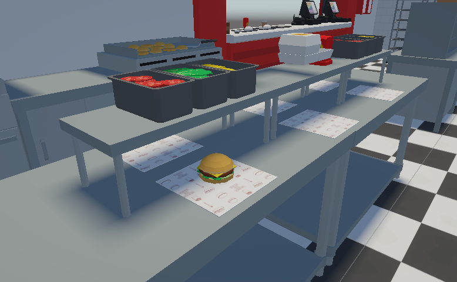
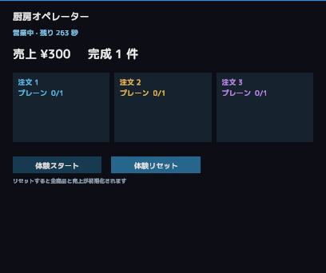
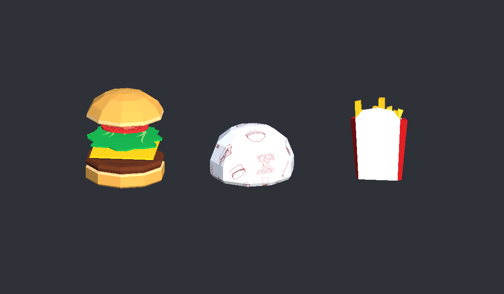
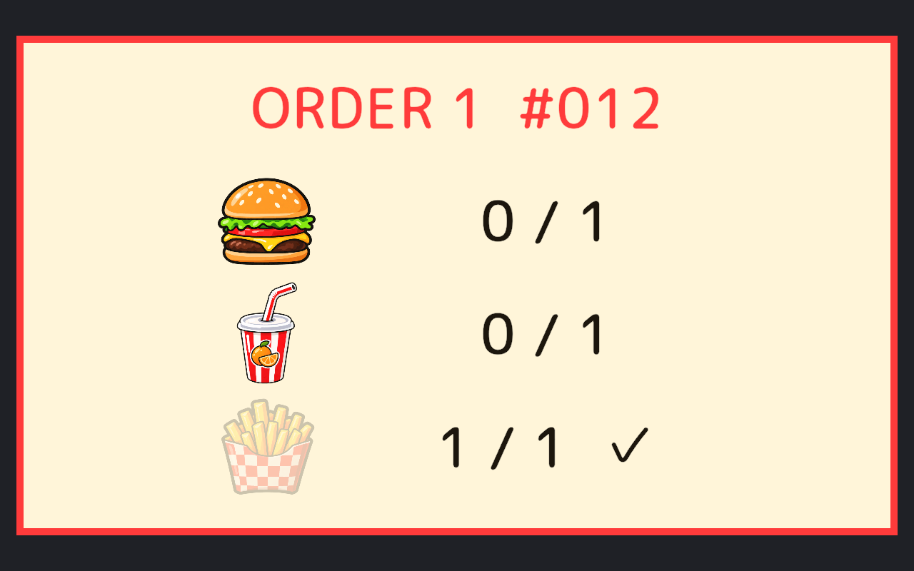
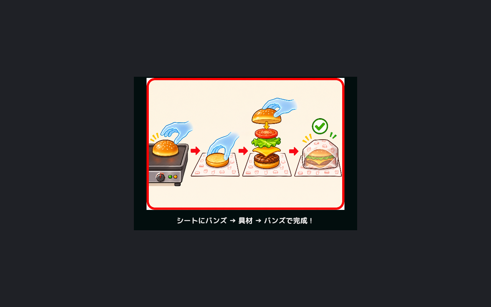
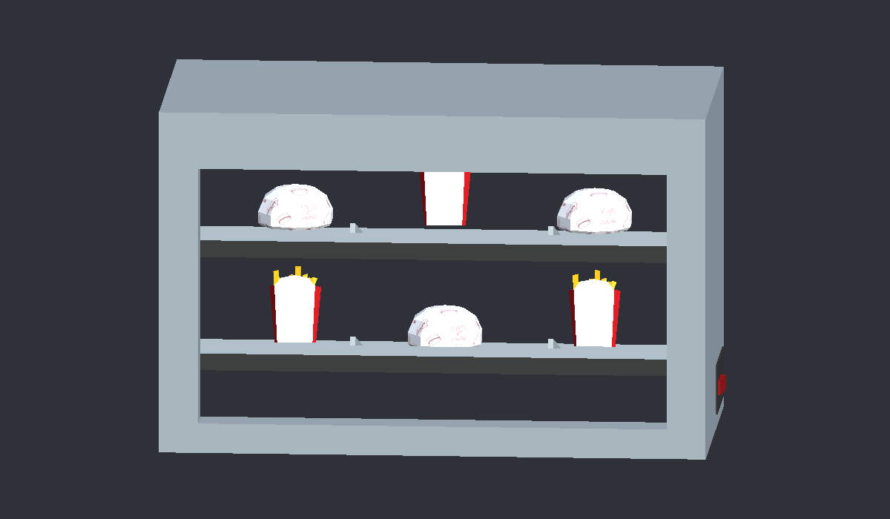
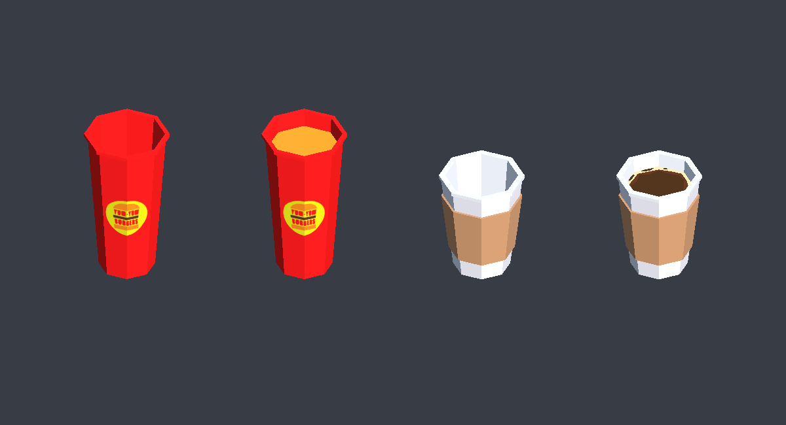
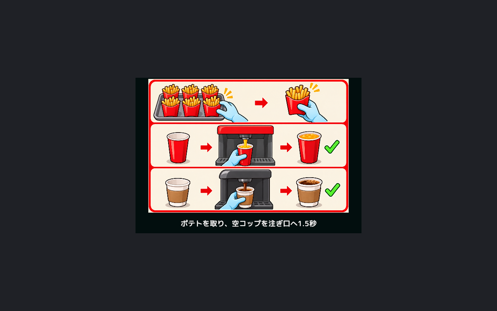
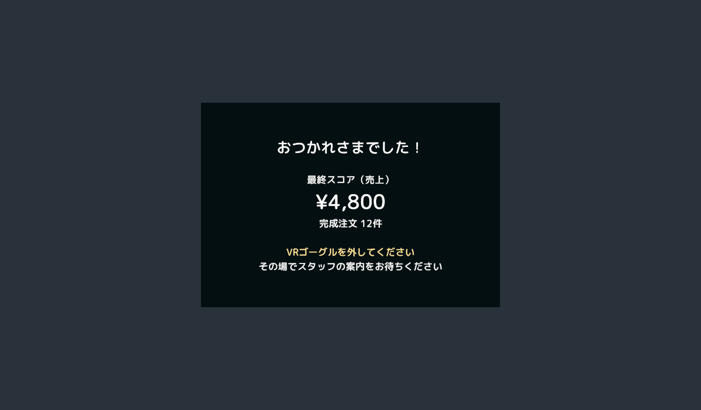

# 掲載画像の候補と出典

元画像をそのままコピーし、9点すべて目視確認済み。新規撮影・画像編集・画像生成はしていません。画像の日時はファイル名と作業記録によります。

## 01-kitchen-workbench.png

本文採用。作業シート・食材・厨房の見た目。途中配置の参考スクショ。

- 種別：厨房の配置
- 日時：2026-11-16（元ファイル名）
- 寸法：778 × 480px
- 元パス（Unityプロジェクト基準）：`Assets/Image/スクリーンショット 2026-11-16 012145.png`

## 02-operator-debug.png

本文採用。300円・完成1件。408px幅のため誌面では小さめに配置。最新の運営画面ではない。

- 種別：運営画面のデバッグ
- 日時：2026-11-14
- 寸法：408 × 342px
- 元パス（Unityプロジェクト基準）：`.local/kitchen-screens/Rendering_20261114_013119_089.png`

## 03-food-preview.png

本文採用。完成形・包装・ポテトを実アセットで描画。展示実写やHMD映像ではない。

- 種別：食品の検証用プレビュー
- 日時：2026-11-17
- 寸法：1200 × 700px
- 元パス（Unityプロジェクト基準）：`.local/comfort/food-preview.png`

## 04-order-monitor.png

本文採用。商品アイコン・提供数・完了チェック。数値は検証用。

- 種別：注文モニターの検証用プレビュー
- 日時：2026-11-17（最終再描画記録）
- 寸法：1280 × 800px
- 元パス（Unityプロジェクト基準）：`.local/polish-preview/4.png`

## 05-tutorial-burger.png

本文採用。生成イラスト＋短いTMP説明。操作の概念図である。

- 種別：説明UIの検証用プレビュー
- 日時：2026-11-17（最終再描画記録）
- 寸法：1280 × 800px
- 元パス（Unityプロジェクト基準）：`.local/polish-preview/0.png`

## 06-shared-storage.png

予備。上下3枠ずつのバーガー・ポテト用共有棚。ドリンクは保管対象外。

- 種別：共有保管棚の検証用プレビュー
- 日時：2026-11-17
- 寸法：1200 × 700px
- 元パス（Unityプロジェクト基準）：`.local/comfort/storage-preview.png`

## 07-drink-cups.png

予備。左からジュース空/入り、コーヒー空/入り。種別と状態を見せる。

- 種別：飲料の検証用プレビュー
- 日時：2026-11-14
- 寸法：1200 × 650px
- 元パス（Unityプロジェクト基準）：`.local/drink-cups/preview.png`

## 08-tutorial-sides.png

予備。生成したポテト・ドリンクの概念図と1.5秒の説明。

- 種別：説明UIの検証用プレビュー
- 日時：2026-11-17（最終再描画記録）
- 寸法：1280 × 800px
- 元パス（Unityプロジェクト基準）：`.local/polish-preview/1.png`

## 09-results-preview.png

予備。売上4800円・12件はプレビュー用データ。展示の実績として使わない。

- 種別：終了UIの検証用プレビュー
- 日時：2026-11-14
- 寸法：1280 × 750px
- 元パス（Unityプロジェクト基準）：`.local/audio-session/Results.png`

合成された宣伝画像、応募用コンセプト画像、空のUI枠、文字が欠けた初期画面は採用しませんでした。会場写真は後日追加です。
